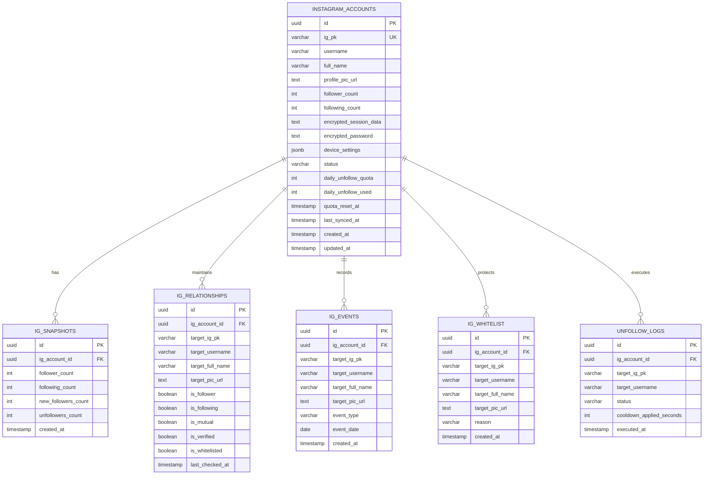

# Skema Database & Relasi (Database Schema)
# Proyek: GaMutual (Instagram Mutual & Unfollower Tracker)

- **Versi:** 2.0.0 (Tersinkronisasi dengan Desain Visual UI/UX)
- **Status:** Approved / Siap Eksekusi

---

## 1. Entity-Relationship Diagram (ERD)



---

## 2. Definisi Tabel PostgreSQL (DDL)

### 2.1. Tabel `instagram_accounts`
Menyimpan akun Instagram yang terhubung langsung, sesi terenkripsi, profil, dan kuota anti-ban.
```sql
CREATE TABLE instagram_accounts (
    id UUID PRIMARY KEY DEFAULT gen_random_uuid(),
    ig_pk VARCHAR(64) UNIQUE NOT NULL,             -- ID numerik Instagram resmi
    username VARCHAR(100) NOT NULL,
    full_name VARCHAR(150),
    profile_pic_url TEXT,
    follower_count INT DEFAULT 0,
    following_count INT DEFAULT 0,
    encrypted_session_data TEXT NOT NULL,          -- Sesi cookies (sessionid, csrftoken) AES-256
    encrypted_password TEXT,                       -- Kata sandi terenkripsi untuk auto-reauth jika sesi mati
    device_settings JSONB,                         -- Parameter fingerprint smartphone konsisten
    status VARCHAR(50) DEFAULT 'ACTIVE',           -- 'ACTIVE', 'CHALLENGE_REQUIRED', 'EXPIRED'
    daily_unfollow_quota INT DEFAULT 40,           -- Batas kuota harian anti-ban (default: 40)
    daily_unfollow_used INT DEFAULT 0,             -- Jumlah kuota yang telah digunakan hari ini
    quota_reset_at TIMESTAMP WITH TIME ZONE,       -- Waktu reset kuota (setiap 00:00 WIB)
    last_synced_at TIMESTAMP WITH TIME ZONE,       -- Terakhir kali snapshot followers/following diambil
    remember_device BOOLEAN DEFAULT TRUE,          -- Opsi "Ingat perangkat ini selama 30 hari"
    created_at TIMESTAMP WITH TIME ZONE DEFAULT CURRENT_TIMESTAMP,
    updated_at TIMESTAMP WITH TIME ZONE DEFAULT CURRENT_TIMESTAMP
);
CREATE INDEX idx_ig_accounts_username ON instagram_accounts(username);
```

### 2.2. Tabel `ig_relationships`
Menyimpan status relasi seluruh akun pengikut dan yang diikuti secara terstruktur untuk mendukung pencarian dan filter di halaman **Unfollower**.
```sql
CREATE TABLE ig_relationships (
    id UUID PRIMARY KEY DEFAULT gen_random_uuid(),
    ig_account_id UUID NOT NULL REFERENCES instagram_accounts(id) ON DELETE CASCADE,
    target_ig_pk VARCHAR(64) NOT NULL,
    target_username VARCHAR(100) NOT NULL,
    target_full_name VARCHAR(150),
    target_pic_url TEXT,
    is_follower BOOLEAN NOT NULL DEFAULT FALSE,    -- Apakah akun ini follow kita?
    is_following BOOLEAN NOT NULL DEFAULT FALSE,   -- Apakah kita follow akun ini?
    is_mutual BOOLEAN GENERATED ALWAYS AS (is_follower AND is_following) STORED,
    is_verified BOOLEAN DEFAULT FALSE,
    is_whitelisted BOOLEAN DEFAULT FALSE,          -- Apakah masuk list terlindungi?
    last_checked_at TIMESTAMP WITH TIME ZONE DEFAULT CURRENT_TIMESTAMP,
    CONSTRAINT uq_account_target UNIQUE (ig_account_id, target_ig_pk)
);

-- Indeks performa untuk query "Tidak Follback (GaMutual)"
CREATE INDEX idx_rel_non_mutual ON ig_relationships(ig_account_id) 
WHERE is_following = TRUE AND is_follower = FALSE;

-- Indeks performa untuk filter "Terlindungi (Whitelist)"
CREATE INDEX idx_rel_whitelisted ON ig_relationships(ig_account_id) 
WHERE is_whitelisted = TRUE;

-- Indeks pencarian username dan nama
CREATE INDEX idx_rel_search ON ig_relationships(ig_account_id, target_username, target_full_name);
```

### 2.3. Tabel `ig_events` (Untuk Activity Page)
Mencatat riwayat aktivitas pergerakan relasi akun terkelompok tanggal secara real-time.
```sql
CREATE TABLE ig_events (
    id UUID PRIMARY KEY DEFAULT gen_random_uuid(),
    ig_account_id UUID NOT NULL REFERENCES instagram_accounts(id) ON DELETE CASCADE,
    target_ig_pk VARCHAR(64) NOT NULL,
    target_username VARCHAR(100) NOT NULL,
    target_full_name VARCHAR(150),
    target_pic_url TEXT,
    event_type VARCHAR(50) NOT NULL,               -- 'UNFOLLOWED_YOU', 'NEW_FOLLOWER', 'YOU_UNFOLLOWED'
    event_date DATE NOT NULL DEFAULT CURRENT_DATE,  -- Digunakan untuk grouping header "Hari Ini", "Kemarin"
    created_at TIMESTAMP WITH TIME ZONE DEFAULT CURRENT_TIMESTAMP
);
CREATE INDEX idx_events_grouping ON ig_events(ig_account_id, event_date DESC, created_at DESC);
CREATE INDEX idx_events_type ON ig_events(ig_account_id, event_type);
```

### 2.4. Tabel `ig_whitelist` (List Terlindungi)
Menyimpan proteksi akun favorit agar tidak sengaja ter-unfollow.
```sql
CREATE TABLE ig_whitelist (
    id UUID PRIMARY KEY DEFAULT gen_random_uuid(),
    ig_account_id UUID NOT NULL REFERENCES instagram_accounts(id) ON DELETE CASCADE,
    target_ig_pk VARCHAR(64) NOT NULL,
    target_username VARCHAR(100) NOT NULL,
    target_full_name VARCHAR(150),
    target_pic_url TEXT,
    reason VARCHAR(255) DEFAULT 'Akun Terlindungi',
    created_at TIMESTAMP WITH TIME ZONE DEFAULT CURRENT_TIMESTAMP,
    CONSTRAINT uq_whitelist_target UNIQUE (ig_account_id, target_ig_pk)
);
CREATE INDEX idx_whitelist_acc ON ig_whitelist(ig_account_id, target_ig_pk);
```

### 2.5. Tabel `unfollow_logs` (Audit Log Aksi Unfollow)
Mencatat riwayat setiap tombol unfollow yang dieksekusi dari aplikasi GaMutual.
```sql
CREATE TABLE unfollow_logs (
    id UUID PRIMARY KEY DEFAULT gen_random_uuid(),
    ig_account_id UUID NOT NULL REFERENCES instagram_accounts(id) ON DELETE CASCADE,
    target_ig_pk VARCHAR(64) NOT NULL,
    target_username VARCHAR(100) NOT NULL,
    status VARCHAR(50) NOT NULL,                   -- 'SUCCESS', 'FAILED', 'COOLDOWN_BLOCKED'
    cooldown_applied_seconds INT DEFAULT 10,       -- Jeda waktu acak yang diterapkan (8-15s)
    executed_at TIMESTAMP WITH TIME ZONE DEFAULT CURRENT_TIMESTAMP
);
CREATE INDEX idx_unfollow_audit ON unfollow_logs(ig_account_id, executed_at DESC);
```
