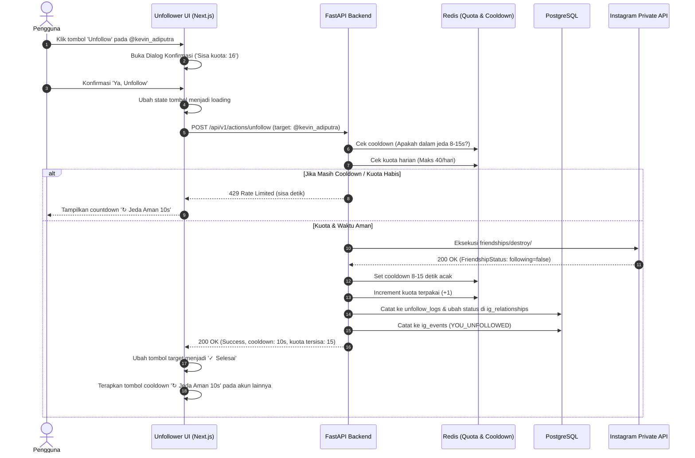

# Arsitektur Sistem & Cara Kerja (System Architecture)
# Proyek: GaMutual (Instagram Mutual & Unfollower Tracker)

- **Versi:** 2.0.0 (Tersinkronisasi dengan Desain Visual UI/UX)
- **Status:** Approved / Siap Eksekusi

---

## 1. Arsitektur Komponen Keseluruhan (High-Level Architecture)

```mermaid
graph TB
    subgraph ClientLayer [Frontend - Next.js 14 App Router]
        Shell[Mobile-First App Shell & Floating Pill Nav]
        TabHome[Tab 1: Home Dashboard & Metrics]
        TabUnfoll[Tab 2: Unfollower Management & Cooldown Guard]
        TabActivity[Tab 3: Activity Timeline Feed]
        ModalAuth[Modal 2FA Challenge & Account Switcher]
    end

    subgraph APILayer [Backend Gateway - FastAPI]
        AuthRouter[/api/v1/auth/instagram]
        DashboardRouter[/api/v1/dashboard & /quota]
        ActionRouter[/api/v1/actions/unfollow]
        ActivityRouter[/api/v1/activities]
        SecurityGuard[AES-256 Engine & Rate Limit Guard]
    end

    subgraph EngineLayer [Instagram Scraper & Action Engine]
        IGClient[instagrapi / Mobile Emulation Client]
        ProxyRouter[Residential Proxy Rotator]
        SyncWorker[Celery / Redis Background Worker]
    end

    subgraph DataLayer [Storage & Persistence]
        Postgres[(PostgreSQL: Accounts, Snapshots, Relationships, Logs)]
        RedisCache[(Redis: 8-15s Cooldown Timers, Quota Bucket, Tasks Queue)]
    end

    Shell --> TabHome & TabUnfoll & TabActivity & ModalAuth
    TabHome & TabUnfoll & TabActivity -->|REST API Calls| APILayer
    APILayer --> SecurityGuard
    SecurityGuard --> Postgres & RedisCache

    APILayer -->|Async Sync Trigger| SyncWorker
    SyncWorker --> IGClient
    ActionRouter -->|Direct Unfollow| IGClient
    IGClient --> ProxyRouter
    ProxyRouter -->|HTTPS Emulated Mobile Request| MetaInstagram[Instagram Official Private Endpoints]
```

---

## 2. Alur Kerja Logika Inti (Core Logic Workflows)

### 2.1. Alur Otentikasi Langsung Instagram & 2FA
1. Pengguna mengisi form pada `Login Page.jpg` dengan `username` dan `password` Instagram.
2. Endpoint `POST /api/v1/auth/instagram/login` menerima payload.
3. Backend memanggil engine `instagrapi` dengan identitas perangkat (*device fingerprinting*) yang konsisten.
4. **Skenario A (Sukses):** Instagram mengembalikan `sessionid`. Sesi dienkripsi (AES-256-GCM) dan disimpan di PostgreSQL. JWT token aplikasi diterbitkan dan frontend diarahkan ke `Home Page`.
5. **Skenario B (Challenge / 2FA):** Instagram mengembalikan status `two_factor_required` atau `checkpoint_required`. Backend mengembalikan HTTP 202 dengan `challenge_type`. Frontend memunculkan modal input kode OTP secara real-time. Setelah kode dikirim ke `POST /api/v1/auth/instagram/challenge/verify`, sesi resmi aktif.

---

### 2.2. Alur Deteksi Relasi & Komparasi Snapshot
Ketika tombol **"↺ Sinkronisasi Sekarang"** diklik:
1. Permintaan dikirim ke Celery Worker di background untuk mengambil seluruh daftar pengikut (*followers*) dan yang diikuti (*following*).
2. Data dibandingkan dengan snapshot sebelumnya:
   - $\text{Unfollowers} = \text{Followers}_{T-1} \setminus \text{Followers}_T$
   - $\text{Followers Baru} = \text{Followers}_T \setminus \text{Followers}_{T-1}$
   - $\text{Tidak Follback (GaMutual)} = \text{Following}_T \setminus \text{Followers}_T$
   - $\text{Mutuals} = \text{Following}_T \cap \text{Followers}_T$
   - $\text{Belum Difollow (Fans)} = \text{Followers}_T \setminus \text{Following}_T$
3. Peristiwa baru (*events*) otomatis dimasukkan ke tabel `ig_events` dengan timestamp zona waktu WIB untuk memberi makan halaman **Activity Page**.

---

### 2.3. Alur Tindakan Unfollow & Proteksi Anti-Ban (Smart Cooldown)



---

## 3. Komponen Frontend (Next.js 14 App Shell)

Struktur antarmuka menggunakan pendekatan **Mobile-First Container** (`max-w-md mx-auto`) yang responsif untuk smartphone maupun desktop:

- `components/layout/BottomNav.tsx`: Floating pill bar dengan 3 navigasi ikon: Home, Unfollower, Activity.
- `components/home/ProfileHeaderCard.tsx`: Kartu profil ungu gelap dengan avatar, follower/following count, tombol Ganti Akun, dan status enkripsi.
- `components/home/AntiBanQuotaCard.tsx`: Progress bar batas tindakan 24/40 dan tombol Sinkronisasi Sekarang.
- `components/home/RelationMetricsGrid.tsx`: Card hero "Tidak Follback" dan 4 kartu metrik relasi.
- `components/unfollower/UnfollowerList.tsx`: Baris akun dengan tombol Unfollow bertahap (Normal -> Cooldown -> Selesai).
- `components/activity/ActivityTimeline.tsx`: Feed aktivitas terkelompok per tanggal (Hari Ini, Kemarin) dengan tag warna merah/hijau.
- `components/modals/AccountSwitcherModal.tsx`: Bottom sheet untuk beralih atau menambah akun Instagram.
- `components/modals/WhitelistModal.tsx`: Modal untuk mengelola daftar akun yang dilindungi dari unfollow.

---

## 4. Mekanisme Keamanan & Anti-Ban Guard

1. **Randomized Human Interval:** Jeda antar tindakan diacak antara 8 hingga 15 detik untuk menghindari pola otomatisasi bot (*machine signature*).
2. **Hard Daily Cap:** Kuota 40 unfollow per hari. Jika mencapai 40, tombol unfollow otomatis terkunci hingga jam 00:00 WIB.
3. **Dedicated Session Storage:** Session cookie disimpan per-akun. Jika akun Instagram aktif digunakan di smartphone fisik, sistem tidak akan bentrok karena menggunakan *device fingerprint* statis.
4. **Proxy Support:** Mendukung integrasi *Residential Proxy* (HTTP/SOCKS5) saat aplikasi di-hosting di server publik VPS agar IP datacenter tidak dicurigai oleh firewall Meta.
